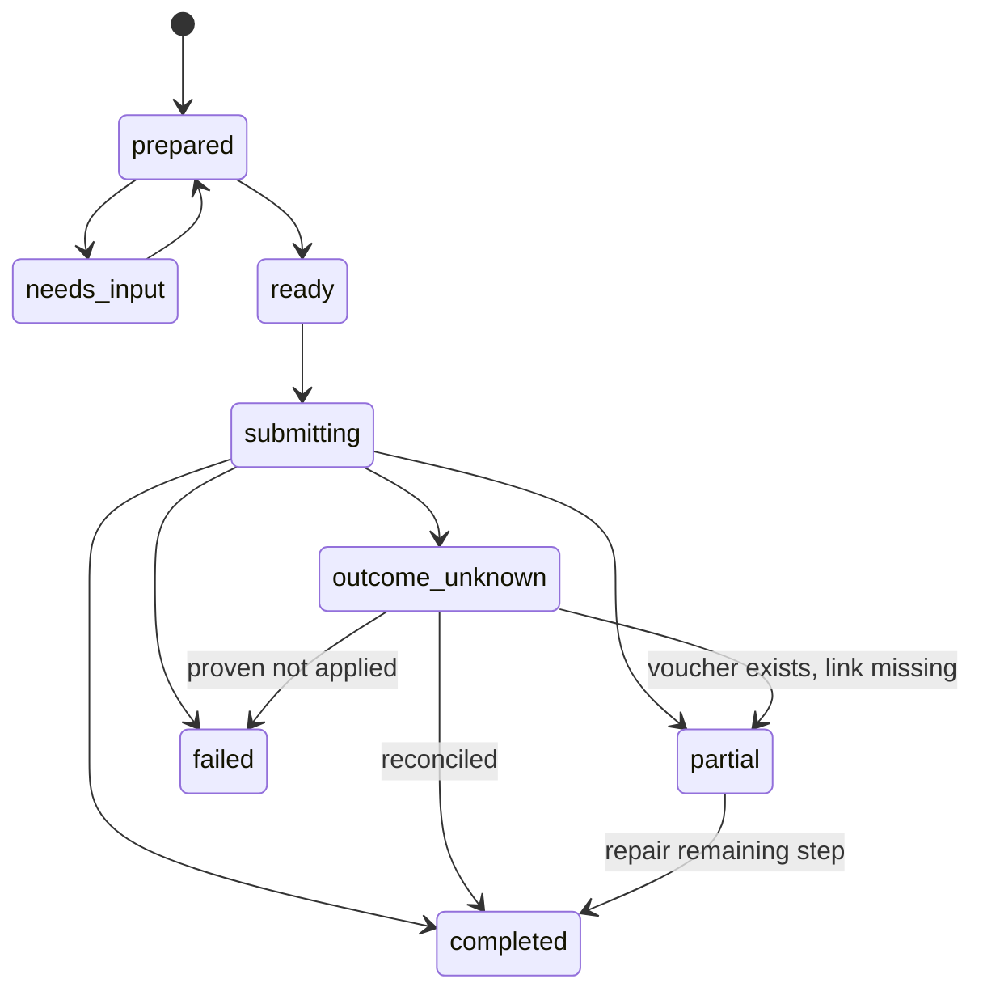

# Receipts, files and batch recovery

Activation update (2026-11-11): [ordinary product activation](../implementation/product-activation-2026-11-11.md) supersedes historical default-off/test-only statements in this document. Acceptance evidence remains unchanged; authorization, policy, validation, source completeness and recovery requirements still apply.

The [milestone 4 product adapter](../implementation/M04-receipts-evidence.md) is in progress. Bounded encrypted staging/readback is implemented behind a default-off gate; this does not establish actual client or Fortnox file support.

Actual client evidence may be collected with the [separate M14 file-test
build](../implementation/M04-client-file-test.md). Its short operator lease,
current file scope and the same owner/company/generation checks authorize only
temporary staging/readback. It enables no proposal, approval, provider file or
financial operation and changes no supported-client/provider claim.

The isolated [S00 file probe](../implementation/S00-files-evidence.md) implements
a default-off synthetic subset of file ingress/egress. Its intentionally narrower
format limits and local evidence do not establish product receipt support or
actual ChatGPT transfer. [Swedish probe instructions](../users/klientprov.sv.md).

## Intended workflow

1. The user provides one or more receipt files in the AI client.
2. The client interprets the images/PDFs and proposes structured accounting inputs. No built-in model/OCR API is required by this server.
3. The server validates file access and inputs, resolves company/year/account references and creates per-item review proposals.
4. The user reviews/approves according to company policy.
5. Upload/link/book in the verified order supported by Fortnox, preserving individual outcomes.
6. Return provider references and evidence; clear temporary file data under retention policy.

The default-off product adapter implements upload, voucher and link as separate
steps. Their complete orchestration is M17; actual provider order/availability
remains subject to #94 evidence. Fortnox writes are not an atomic transaction
across these steps. Never claim automatic rollback. A voucher created
successfully with a failed attachment link is a partially completed item that
needs link repair, not another voucher.

## File ingress and egress

The optional [explicit host picker](../implementation/M04-file-picker-followup.md)
obtains authorized references using feature-detected host APIs when ordinary
message attachment mapping is unavailable. Opening/selection does not stage.
Its separately requested staging/readback uses the same domain checks; no
client URL, widget state or app-only visibility supplies authorization.

Prefer the host's authorized file-input interface. OpenAI's file input metadata and file shapes are client-specific and must be validated against current docs/client behavior; support arrays for multiple receipts. Other clients use a separate supported adapter, not arbitrary file URLs pretending to be host uploads.

Bind file references to owner, company, workflow and expiry. Verify media type using content as well as declared metadata. Enforce documented byte/page limits and reject unsupported content with a clear error. Handle password-protected or unreadable PDFs explicitly. Never execute embedded content or interpret document text as server instructions.

Downloads from approved client file origins must reject private/link-local/metadata IPs, unsafe redirects and credential forwarding. Use short-lived references, bounded streaming, and delete temporary bytes. Do not put expiring download URLs or original document text in logs.

Retrieve existing Fortnox attachments only after checking the company's owning record and connection. Return host-supported file handles or authenticated downloads, not publicly accessible permanent links. Upload/link scopes and Fortnox file format limits are endpoint-specific verification requirements.

The M14 transport follow-up permits an explicitly selected temporary Node relay
for product test preparation. Its independent bearer/deadline, exact helper/source
origins and DNS-pinned Node source fetch are separate from MCP company/grant
authorization and encrypted SQLite/D1 staging. Worker has no direct source-fetch
fallback. This helper-assisted route is not native Worker egress or proof of actual
client transfer. Source settings alone enable no file or financial tool.

M16 exposes default-off typed upload/link/read tools and a company/year/voucher/file
resource. Its [operation ledger](../reference/mvp-receipt-operations.json) records
the fixed provider endpoints and unverified scope/license/format boundaries.
Every upload/link stores a durable step claim before dispatch. Successful or
uncertain steps are never automatically repeated; a restart leaves an unfinished
claim uncertain. Exact positive relationship evidence may resolve an uncertain
link. A missing record is insufficient proof to resend an uncertain write.

## Per-item state machine

Issue #134 adds a separate [positive upload-reconciliation path](../implementation/receipt-upload-recovery-2026-11-12.md).
Current authentication and the original connection generation/client remain
required. Historical policy/byte expiry may differ only for non-dispatching
upload metadata reconciliation. This does not reauthorize historical execution
or restore expired proposals. Missing evidence never proves non-application.

`ready` requires valid inputs and policy-satisfying approval. Client-managed mode still performs validation. `failed` is retryable only when the failed step is known not to have applied and prerequisites still hold. Store step-level IDs and results. Never regress a completed voucher step to pending while repairing its attachment.

## Duplicate handling

Use company-scoped original-file hashes, execution intent IDs, provider references and reconciliation state. A duplicate file hash is a warning/candidate, not a universal ban: two legitimate transactions may have similar data, and the same document may need a corrected link. Conversely, a rescan may have a different hash. Show candidates and require explicit resolution instead of claiming perfect duplicate detection.

Batch results include requested/completed/partial/failed/unknown counts, per-item reasons, next actions and provider identifiers. Retrying only the failed items must not resend completed or unknown items. Never balance different receipts against one another to hide an individually invalid voucher.

The default-off M17 coordinator uses the same accounting execution service for
both reviewed and explicitly client-managed receipts. Resume accepts selected
item IDs and can only reconcile or repair links after successful vouchers. It
never uploads or creates a voucher. An upload-only interruption requires a new
explicit review of the same live immutable proposal before financial dispatch.
Re-review rotates UI-only capability metadata without approving or replacing any
existing execution. Old capabilities fail the durable claim after rotation.
Unresolved financial context and successful vouchers awaiting link repair survive
ordinary retention. Completed bytes are removed per file, preserving other
pending references; scheduled expiry remains the cleanup fallback.
